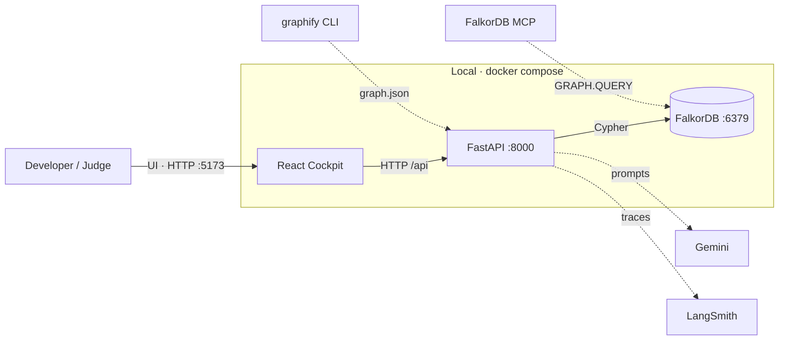

# GraphHacks Nexus — one repo, three tracks, one load-bearing FalkorDB graph

**Track entered: 02 — Agent Memory and Coordination** (plus real, thinner entries in Track 01 and Track 03 that reuse the same substrate).

GraphHacks Nexus turns a simulated multi-agent "cockpit" into a real **FalkorDB**-backed memory system. A single React + FastAPI app reads and writes **three named-graph projections held in one FalkorDB instance**: `tenant:<id>` (Track 02 — episodic, semantic, and procedural memory, handoffs, isolation, concurrency), `code:<repoId>` (Track 01 — the repository's AST graph, queried for blast-radius, PageRank hotspots, and shortest dependency paths), and `company:brain` (Track 03 — people, commits, docs, and code symbols, queried for `who_owns`, `trace_why`, and `detect_drift`). The graph is **load-bearing**: stop FalkorDB and the cockpit stops working — it shows an error screen instead of silently falling back to seed data. That flip is the submission (rule 3).

---

## 1 · Positioning — one repo, three entries

The hackathon entries share one engine; each track is a distinct **projection** served through the same backend and the same cockpit.

| Track | Named graph | Question it answers | Status |
|---|---|---|---|
| **02 (anchor)** | `tenant:<id>` | What did each agent/tenant remember, believe, and know how to do — and who handed what to whom? | **Guaranteed** — all key-focus points proven |
| 01 | `code:<repoId>` | If this symbol changes, what breaks, what is central, and what is the shortest call path? | Real, thin — action engine + decision traces |
| 03 | `company:brain` | Who owns this file, why does it exist, and where has the docs drifted from the code? | Real, thin — local data only (no GitHub token) |

**Track 03 scope note:** no GitHub token is available, so Track 03 is built on **local `git log --numstat`** + **on-disk docs** + **`graphify-out/graph.json`** only. Anything PR-shaped (pull requests, issues, reviews) is explicitly deferred; we did not fake it.

---

## 2 · Architecture

Interactive architecture diagrams (C4 levels, generated with **Archify** — click to open, they're explorable + animated):

- **[System context](./docs/architecture/nexus-context.html)** — who uses it, and the external systems it talks to
- **[Containers](./docs/architecture/nexus-container.html)** — cockpit · FastAPI · FalkorDB · graphify · MCP · Gemini · LangSmith
- **[Backend components](./docs/architecture/nexus-component.html)** — the three engines, the `db.named_graph` router, and the named graphs



Text overview:

```
                 React + Vite + TS cockpit  (src/, D9)
   App.tsx · GraphCanvas · MemoryTiers · HandoffLedger · ControlPanel ·
   Track01Studio · Track03Brain · BackendTab
        │  data seam: src/data/remote.ts  →  HTTP/JSON  /api/*
        │  dev: Vite proxy :5173 → :8000   ·   compose: nginx :80 → backend:8000
        ▼
                 FastAPI backend  (backend/app/, D8, run with uv)
   GET /health · /api/health · /api/tenants
   GET /api/graph/nodes?tenant=… · GET /api/graph/edges?tenant=…
        │   any FalkorDB failure → HTTP 503 (never a silent fallback)
   ┌───────────────┬──────────────────────────┬───────────────────────┐
   │ Track 02       │ Track 01                  │ Track 03              │
   │ memory_service │ graph_sync.py             │ falkor_brain.py       │
   │   .py          │ falkor_action.py          │ who_owns · trace_why  │
   │ episodic ·     │ blast_radius · hotspots · │ · detect_drift        │
   │ semantic ·     │ shortest_dep_path         │                       │
   │ procedural ·   │ (+ DecisionTrace)         │                       │
   │ handoff        │                           │                       │
   └───────────────┴──────────────────────────┴───────────────────────┘
        │  cockpit.py (read projections)   ·   db.named_graph(graph_key) router (D10)
        ▼
                 FalkorDB (Docker) — one instance, three named-graph projections
   tenant:<id>            code:<repoId>              company:brain
   Track 02 memory        Track 01 AST graph         Track 03 people/docs/code
   + graphhacks_registry (tenant list)   + graphhacks_health (health check)
        ▲                              ▲
        │ graphify-out/graph.json       │ git log --numstat + docs/ + reference/ + lessons/
```

- **Hand-rolled orchestration** (D2): no agent framework; the state machine's state *is* the FalkorDB graph.
- **Observability** (D3): every engine call is wrapped in `with span("<area>.<method>"):` (`app/observability.py`); the LangSmith hook is a lazy no-op unless `LANGSMITH_TRACING` is enabled, and its import never blocks startup.
- **One router** (D10): all graph access goes through `db.named_graph(graph_key)`; no query is ever unscoped.

---

## 3 · The graph data model

The **four tiers** below live inside a Track 02 `tenant:<id>` graph, connected — a `:Turn` (episodic) links to an `:Entity` (semantic) links to a `:Workflow` (procedural), with a coordination layer for multi-agent state. Timestamps are Unix epoch seconds. The full node/edge catalogue is `reference/graph-schema.html`; the exact queries are in [`queries.cypher`](./queries.cypher).

### 3.1 The four tiers (Track 02 · `tenant:<id>`)

| Tier | Label | Key properties | Meaning |
|---|---|---|---|
| **Episodic** | `:User` | `id`, `display_name` | The actor linked to past interactions. |
| | `:Session` | `id`, `started_at`, `ended_at`, `title` | A contiguous conversation → persistent history. |
| | `:Turn` | `id`, `timestamp`, `role`, `text`, `response_quality` | One message/event; the atomic episodic record. |
| **Semantic** | `:Entity` | `id`, `name`, `type`, `embedding` | A durable domain object, independent of any one interaction. |
| | `:Fact` | `id`, `statement`, `confidence`, `source_turn` | A durable assertion about the domain. |
| | `:Topic` | `name` | A subject label joining episodic turns and semantic entities. |
| **Procedural** | `:Tool` | `id`, `name`, `signature` | A callable capability (e.g. a Cypher template or Tavily). |
| | `:Workflow` | `id`, `name`, `trigger_domain`, `learned_from` | A reusable, re-executable sequence of steps. |
| | `:Step` | `id`, `order`, `action`, `expected_result` | One action inside a workflow; chained for replay. |
| **Coordination** | `:Agent` | `id`, `name`, `role`, `persona_level` | One of the agent squad (see §7). |
| | `:Handoff` | `id`, `created_at`, `reason`, `status` | Transfer of state/responsibility; `status ∈ {PENDING, COMPLETED, ALERT_RAISED, PLAYBOOK_ENFORCED}`. |

The **isolation boundary** is the graph key itself: `tenant:<tenantId>` (D5). No `:Tenant` node is written inside a tenant graph; the `:Tenant` node lives only in the `graphhacks_registry` graph that backs the tenant list.

**Relationship types** (typed, directed): `:PARTICIPATED` `(User)→(Turn)`, `:PRODUCED` `(Agent)→(Turn)`, `:IN_SESSION` `(Turn)→(Session)`, `:ABOUT` `(Turn)→(Topic)`, `:MENTIONS` `(Turn)→(Entity)`, `:HAS_FACT` `(Entity)→(Fact)`, `:DERIVED_FROM` `(Fact)→(Turn)` *(provenance)*, `:RELATES_TO {type, confidence}` `(Entity)→(Entity)`, `:SAME_TOPIC` `(Topic)→(Topic)`, `:USES` `(Workflow)→(Tool)`, `:START` `(Workflow)→(Step)`, `:NEXT_STEP {order}` `(Step)→(Step)`, `:LEARNED_FROM` `(Workflow)→(Handoff)`, `:EXECUTED {at}` `(Agent)→(Workflow)`, `:HANDED_TO {at}` `(Agent)→(Agent)`, `:FROM_AGENT` `(Handoff)→(Agent)`, `:TO_AGENT` `(Handoff)→(Agent)`, `:TARGETS` `(Handoff)→(Entity)`, `:MODIFIED {op}` `(Turn)→(Entity)`.

Contract resolutions worth naming (full list in `docs/contracts/memory-service.md` §5): **A3/A4** — the `DERIVED_FROM`/`LEARNED_FROM` *edge* is the provenance source of truth; **A5** — user turns use `PARTICIPATED`, agent turns use `PRODUCED`; **A6** — the `:Handoff` node is the ledger, the `HANDED_TO` edge is the coordination skeleton; **A9** — `Step.id` defaults to `"<workflow_id>:step:<order>"`.

### 3.2 The three named graphs (D5 + D10)

One FalkorDB instance holds all projections. All access goes through `db.named_graph(graph_key)`; there are no cross-graph reads.

| Graph key | Owner | Nodes | Edges |
|---|---|---|---|
| `tenant:<tenantId>` | Track 02 (D5) | `:User` `:Session` `:Turn` `:Entity` `:Fact` `:Topic` `:Tool` `:Workflow` `:Step` `:Agent` `:Handoff` `:ConceptNode` | the 20 relationship types above |
| `code:<repoId>` | Track 01 (D10) | `:File{id:"file:<path>"}` `:Symbol{id:<graphify id>}`, `:Test` (co-label) | `:CALLS` `:IMPORTS` `:CONTAINS` `:INHERITS` |
| `company:brain` | Track 03 (D10) | `:Person{id/email}` `:Commit{id/sha}` `:File{id,repo,path,present}` (+`:Doc` co-label) `:Symbol{id,repo,name,present}` | `:AUTHORED` `:MODIFIED{path,insertions,deletions,at}` `:DEFINES` `:MENTIONS` `:DOCUMENTED_IN` |
| `graphhacks_registry` | cockpit | `:Tenant{key,name}` | — |
| `graphhacks_health` | health check | (count only — `MATCH (n) RETURN count(n)`) | — |

Every write is `MERGE`-based and idempotent (re-running leaves counts unchanged). Track 03 never `DETACH DELETE`s: it flags `present = false` pre-pass and `true` on sight, so a removed symbol/file is the drift signal.

---

## 4 · Run it

### Option A — local (verified end-to-end)

Prerequisites: Docker, Node 18+, and [`uv`](https://docs.astral.sh/uv/).

```bash
# 1. FalkorDB (Redis protocol :6379, Browser UI :3000)
docker run -d --name falkordb -p 6379:6379 -p 3000:3000 falkordb/falkordb:latest

# 2. Seed the tenant registry + tenant graphs (idempotent; needs FalkorDB only)
cd backend && uv run python scripts/seed_cockpit.py

# 3. FastAPI backend (from backend/). `--env-file ../.env` loads Nebius/Tavily keys.
uv run uvicorn app.main:app --port 8000 --env-file ../.env

# 4. Cockpit (repo root, new terminal) → http://localhost:5173
npm install && npm run dev
```

Sanity checks:

```bash
curl -s localhost:8000/api/health            # {"status":"ok",...,"node_count":1}
curl -s localhost:8000/api/tenants           # {"tenants":[{"key":"graphsync_user1_ai_avatar_saas",...}]}
cd backend && uv run python health.py        # FalkorDB OK — MATCH (n) RETURN count(n) => N
```

> Secrets (Nebius LLM, Tavily search, LangSmith) are **optional** for the demo. Copy `.env.example` → `.env` (repo root) and fill in `NEBIUS_API_KEY` / `TAVILY_API_KEY`; the backend loads them via uvicorn `--env-file ../.env`. Never commit `.env`. Nothing above requires a key — with no keys the app still runs (deterministic fallback).

### Load any repo (paste a link)

```bash
curl -s -X POST localhost:8000/api/repos/load -H 'Content-Type: application/json' \
  -d '{"url":"https://github.com/pallets/click"}'
# → {"repo_id":"click","name":"click","files":...,"symbols":...,...}
curl -s "localhost:8000/api/track1/hotspots?repo=click&limit=5"      # hotspots for that repo
curl -s -X POST localhost:8000/api/guidance -H 'Content-Type: application/json' \
  -d '{"repo":"click","level":4}'                                     # graph-grounded L4 audit
```

The cockpit exposes the same flow via the repo bar (paste URL → load → pick repo). Guidance needs `NEBIUS_API_KEY` for the LLM text; without it the endpoint still returns the graph facts (hotspots/blast-radius/owners/drift) that the answer is grounded in.

### Option B — Docker Compose (one command, D4)

```bash
docker compose up --build          # → http://localhost:5173
docker compose exec backend uv run python scripts/seed_cockpit.py   # seed once
```

The compose stack is FalkorDB + the FastAPI backend + an nginx-served cockpit (`deploy/nginx.conf` proxies `/api/` → `backend:8000`). `docker compose config` validates.

### The rule-3 proof (do this in the demo)

```bash
docker compose stop falkordb        # or: docker stop falkordb
# reload http://localhost:5173  → ErrorScreen ("FalkorDB unavailable (ConnectionError)")
docker compose start falkordb       # or: docker start falkordb
# click Retry → the seeded graph renders again
```

The cockpit has **no fallback to `INITIAL_TENANTS`**: `src/data/index.ts` fetches the real graphs and a failure surfaces as an error, by design.

---

## 5 · Run the proof scripts

Eight runnable checks back every claim below (run from `backend/`):

```bash
uv run python health.py
uv run python scripts/verify_t2_2.py   # turns=2 order=user,agent
uv run python scripts/verify_t2_3.py   # semantic=1 facts=1 source=ok
uv run python scripts/verify_t2_4.py   # workflow=1 steps=3 start=ingest
uv run python scripts/verify_t3_1.py   # handoffs=1 edge=1
uv run python scripts/verify_t3_2.py   # tenant_a=3 tenant_b=0
uv run python scripts/verify_t3_3.py   # writers=16 distinct=16 same=1
uv run python scripts/verify_track1.py # TRACK1 OK
uv run python scripts/verify_track3.py # track3 OK — ... cited=100%
```

| Claim (Track 02 key focus) | Evidence |
|---|---|
| Episodic memory | `turns=2 order=user,agent` |
| Semantic memory | `semantic=1 facts=1 source=ok` |
| Procedural memory | `workflow=1 steps=3 start=ingest` |
| Handoffs / shared state | `handoffs=1 edge=1` |
| Per-tenant isolation | `tenant_a=3 tenant_b=0` |
| High-concurrency writes | `writers=16 distinct=16 same=1` |
| Explainable answers | every Track 01/03 answer carries its Cypher, params, nodes/edges and query time (`DecisionTrace`); `trace_why` is 100%-cited |
| Graph does real work (rule 3) | stop FalkorDB → `503` → `ErrorScreen`; start → `Retry` renders |
| Persistent history | history lives in `tenant:<id>`; reopen → still present |

---

## 6 · Cypher queries

The real queries the product depends on are in [`queries.cypher`](./queries.cypher), grouped by track: episodic/semantic/procedural/handoff (Track 02), load / blast-radius / PageRank / `algo.SPpaths` (Track 01), and ingest / `who_owns` / `trace_why` / `detect_drift` (Track 03). Every query is parameterised; the only inlined values are Python-validated ints in `LIMIT`/`*..N`, which FalkorDB does not accept as parameters.

---

## 7 · The narrative — vibe-coder → principal-architect

The graph persists an escalation, not just messages. Four agents form the squad (seeded as `:Agent` nodes and driven through `record_handoff`), each owning a persona level L0–L5:

| Agent | Persona | Job |
|---|---|---|
| **VibeArchitect** | L0–L1 | Turns a prompt into the human-readable "vibe" view (L0) and its unit economics (L1). |
| **FullStackBuilder** | L2–L3 | Wires UI → API → FalkorDB and writes the production implementation (L2–L3). |
| **SeniorAuditor** | L4 | Audits security/spend and proves formal bounds (L4). |
| **PrincipalResearcher** | L5 | Researches external best practice and formal methods (L5). |

The seeded ledger shows the escalation end-to-end: `VibeArchitect (L0-L1) → FullStackBuilder (L2-L3) → SeniorAuditor (L4-L5) → LearningCoach`. When the auditor raises `ALERT_RAISED`, that status is a property of a `:Handoff` node whose `FROM_AGENT`/`TO_AGENT`/`TARGETS` edges point at the concrete agent and the affected `:ConceptNode` — so the whole escalation is a **queryable path in the graph**, not a log line. `save_workflow` then records *what the team learned* as a replayable `:Workflow` linked back to that handoff via `:LEARNED_FROM`, and `replay_workflow` records the re-execution as `(:Agent)-[:EXECUTED {at}]->(:Workflow)`. That is the arc: a vibe prompt becomes a code change, becomes an audit, becomes durable procedural memory.

---

## 8 · Demo video

> **Placeholder — record before submission.** A 3-minute, click-by-click script (spin up → rule-3 flip → Track 02 memory & swarm → Track 01 blast radius → Track 03 who-owns/trace → wrap) is in [`docs/guides/DEMO-SCRIPT.md`](./docs/guides/DEMO-SCRIPT.md).
>
> `[ demo video link — YouTube/Drive — TBD ]`

---

## 9 · AI-assistant disclosure (rule 11)

**An AI coding assistant (opencode, using AI subagents) wrote and edited source code, scripts, and documentation in this repository under the participant's direction and review.** The participant designed the system, chose the architecture and data model, set the constraints (the contract, the decisions in `docs/decisions.md`), and ran and verified every exit criterion above. The participant is responsible for the correctness of all content and can explain the graph model, the queries, the architecture, and the decisions on demand (rules 11–12). No AI output was accepted without executing its verification step. AI tools used: opencode (coding assistant).

---

## 10 · Submission checklist (rule 10)

- [x] Public source-code repository (this repo)
- [x] README with setup instructions **and** the graph data model (§3, §4)
- [x] The real Cypher queries / graph algorithms ([`queries.cypher`](./queries.cypher))
- [ ] Demo video of the working project (§8 — placeholder linked)
- [x] Complete local setup instructions (§4 — Option A verified; Option B Compose)
- [x] The track entered: **Track 02 — Agent Memory and Coordination** (plus thin Track 01/03 entries on the same engine)
- [x] AI-assistant use disclosed (rule 11, §9)

---

## 11 · Decisions & further reading

- `docs/decisions.md` — decision records D1–D11 (language, orchestration, observability, deployment, memory model, contract, execution, Python port, frontend modules, named-graph topology, cockpit projection + registry).
- `docs/contracts/memory-service.md` — the language-agnostic `MemoryService` contract + ambiguity resolutions A1–A10.
- `reference/graph-schema.html` — the canonical four-tier model; `reference/features.html` — the Track 02 feature set and rule-10 artifacts.
- `docs/superpowers/specs/2026-10-17-nexus-three-tracks-design.md` and the matching plan — the three-track design and implementation plan.
- `graphify-out/graph.json` + `graphify-out/GRAPH_REPORT.md` — the project's own AST knowledge graph (what Track 01 loads).
