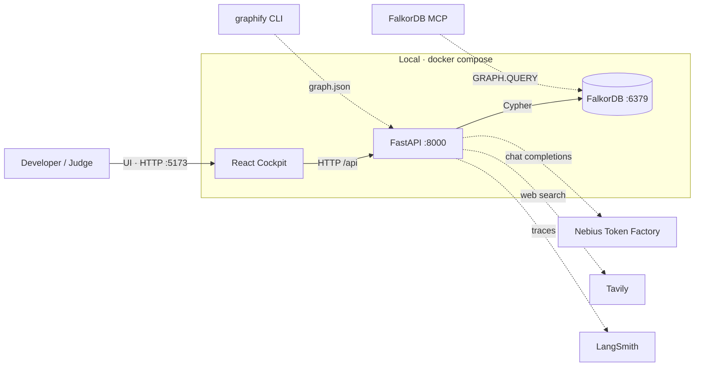

# GraphHacks Nexus — a FalkorDB-backed Builder-Maturity cockpit

**Track entered: 02 — Agent Memory and Coordination** (plus real, thinner Track 01 and Track 03 entries that reuse the same substrate and the same FalkorDB instance).

GraphSync Nexus is a multi-agent cockpit whose **memory is a real FalkorDB graph**. You give the 4-agent squad a feature prompt (or paste any GitHub URL); the agents write a six-level **L0 → L5 maturity stack** into FalkorDB as connected `:ConceptNode` nodes, persisted alongside episodic `:Turn`s, a coordination `:Handoff` ledger, and reusable procedural `:Playbook` workflows. A **Builder Maturity Dial (L0–L5)** and **17 Domain Lenses** let one graph be read at six depths: from a plain-English "vibe" card (L0) to formal complexity bounds (L5).

The graph is **load-bearing**: stop FalkorDB and the cockpit stops working — it shows an error screen instead of silently falling back to seed data. That flip is the submission (rule 3).

---

## 1 · What it is

One React + FastAPI app over **one FalkorDB instance** holding three named-graph projections:

| Track | Named graph | Question it answers |
|---|---|---|
| **02 (anchor)** | `tenant:<id>` | What did each agent/tenant remember, believe, hand off, and learn how to do? |
| 01 | `code:<repoId>` | If this symbol changes, what breaks, what is central, and what is the shortest call path? |
| 03 | `company:brain` | Who owns this file, why does it exist, and where have the docs drifted from the code? |

### The core loop (Track 02)

1. **Ask the squad to build a feature.** Type anything ("Add ElevenLabs AI Voice Cloning Endpoint") into the Nebius 4-agent prompt bar.
2. **Four agents synthesize L0–L5.** VibeArchitect→FullStackBuilder→SeniorAuditor→PrincipalResearcher write six linked `:ConceptNode`s and their typed edges, plus an episodic `:Turn` and a coordination `:Handoff`.
3. **Read the graph at six levels.** The **Builder Maturity Dial** filters L0→Lm: L0 Vibe Coder · L1 Indie Hacker/PM · L2 Junior Dev · L3 Full-Stack Engineer · L4 Senior Staff · L5 Principal/Researcher.
4. **The graph remembers.** Before building, `FullStackBuilder` queries procedural memory (`:Playbook`). If a matching guardrail exists (e.g. a rate-limit learning from a past audit), it is applied automatically — and the new stack is born protected.
5. **Guardrails bubble up.** A senior L4 risk is linked to the endangered L0 card by an `[:ENDANGERS]` edge; the L0 user sees a plain-English warning and a **1-Click Senior Fix** button that persists a new `:Playbook` + `:Handoff` + `:Turn` to FalkorDB, so *future* features inherit the fix.

### The three lenses

- **17 Domain Lenses** — every `:ConceptNode` carries a `domain`: Frontend, Backend, Database, Learning Bridge, Research, Existing Projects, End Users, Mathematics, Tech Stack, Brainstorming, Programming Language, Business & Cost, AI Models & Prompts, External APIs, Security & Auth, Infra & DevOps, Testing & Edge Cases. Filter the canvas by pillar (Engineering · Discovery · Foundations · Production).
- **Repo Graph lens** — flip the cockpit to `code:<repoId>` and explore any loaded repo's own AST graph (top-PageRank symbols + CALLS/IMPORTS/CONTAINS/INHERITS edges) on the same 2D canvas.
- **Any repo, any time** — paste a GitHub URL; the backend clones it, builds its AST graph with `graphify`, loads `code:<slug>` + `company:brain`, and registers it.

### Graph-grounded guidance

`POST /api/guidance` feeds **real Track 01/03 facts** (PageRank hotspots, blast radius, owners, spec/doc drift) into the LLM, which then explains *this* repository at a chosen maturity level L0–L5. The endpoint returns the facts alongside the answer, so the grounding is verifiable — and the LLM provably cannot produce the good answer without FalkorDB.

See `docs/guides/DEMO-SCRIPT.md` for the click-by-click walkthrough.

---

## 2 · The graph does real work (rule 3)

The cockpit has **no fallback to `INITIAL_TENANTS`**: `src/data/remote.ts` fetches the real graphs and a failure surfaces as `ErrorScreen`, by design.

```bash
docker stop falkordb        # or: docker compose stop falkordb
# reload http://localhost:5173  → ErrorScreen ("FalkorDB unavailable (ConnectionError)")
curl -s -o /dev/null -w '%{http_code}\n' 'http://localhost:8000/api/graph/nodes?tenant=graphsync_user1_ai_avatar_saas'  # → 503
docker start falkordb       # click Retry → the seeded graph renders again
```

Every write and read goes to FalkorDB through the `MemoryService` contract; there is no JSON/cache path that survives the database being gone.

---

## 3 · Architecture

Interactive architecture diagrams (C4 levels, generated with **Archify** — click to open, explorable + animated):

- **[System context](./docs/architecture/nexus-context.html)** — who uses it, and the external systems it talks to
- **[Containers](./docs/architecture/nexus-container.html)** — cockpit · FastAPI · FalkorDB · graphify · MCP · **Nebius** · Tavily · LangSmith
- **[Backend components](./docs/architecture/nexus-component.html)** — the three engines, the `db.named_graph` router, and the named graphs



Text overview:

```
                 React + Vite + TS cockpit  (src/, D9)
   App · ControlPanel (maturity dial + prompt bar + repo loader) · GraphCanvas
   RepoGraphCanvas · NodeInspector · HandoffLedger · MemoryTiers ·
   DomainFilterBar · Track01Studio · Track03Brain · BackendTab
        │  data seam: src/data/remote.ts  →  HTTP/JSON  /api/*
        │  dev: Vite proxy :5173 → :8000   ·   compose: nginx :80 → backend:8000
        ▼
                 FastAPI backend  (backend/app/, D8, run with uv)
   GET  /api/health · /api/tenants · /api/graph/nodes · /api/graph/edges
   POST /api/track2/{turn,workflow,handoff,graph}      ← cockpit write path
   GET  /api/track1/{hotspots,blast-radius,shortest-path,graph} · POST /api/track1/sync
   GET  /api/track3/{who-owns,trace,drift}              · POST /api/track3/sync
   POST /api/repos/load · GET /api/repos                ← any-repo loading
   POST /api/guidance                                   ← graph-grounded L0–L5 guidance
   POST /api/gemini/generate (legacy shape → Nebius) · POST /api/research (Tavily)
        │   any FalkorDB failure → HTTP 503 (never a silent fallback)
    ┌───────────────┬──────────────────────────┬───────────────────────┐
    │ Track 02       │ Track 01                  │ Track 03              │
    │ memory_service │ graph_sync.py             │ falkor_brain.py       │
    │   .py          │ falkor_action.py          │ who_owns · trace_why  │
    │ episodic ·     │ blast_radius · hotspots · │ · detect_drift        │
    │ semantic ·     │ shortest_dep_path         │                       │
    │ procedural ·   │ (+ DecisionTrace)         │                       │
    │ handoff        │                           │                       │
    └───────────────┴──────────────────────────┴───────────────────────┘
        │  cockpit.py (read projections)   ·   db.named_graph(graph_key) router (D10)
        ▼
                 FalkorDB (Docker) — one instance, six named graphs
   tenant:<id>        code:<repoId>       company:brain
   Track 02 memory    Track 01 AST graph  Track 03 people/docs/code
   + graphhacks_registry (tenants)  + graphhacks_repos (loaded repos)  + graphhacks_health
```

- **LLM provider (D12):** **Nebius Token Factory** (OpenAI-compatible), not Gemini. The single seam is `app/llm.py`. The legacy `/api/gemini/generate` route is kept and now proxies to Nebius, so the browser bundle contract is unchanged and **no key ever ships to the client**.
- **Web search (D12):** **Tavily** via `app/search.py` (`POST /api/research`) for the L4/L5 prior-art step, with cited sources.
- **Hand-rolled orchestration (D2):** no agent framework; the state machine's state *is* the FalkorDB graph.
- **Observability (D3):** every engine call is wrapped in `with span("<area>.<method>"):` (`app/observability.py`); the LangSmith hook is a lazy no-op unless `LANGSMITH_TRACING` is enabled.
- **One router (D10):** all graph access goes through `db.named_graph(graph_key)`; no query is ever unscoped.
- **Provider degradation (keyless-safe):** missing Nebius/Tavily keys degrade (503 or `answer=null`), never crash. Only FalkorDB is a hard dependency.

---

## 4 · The graph data model

The **four tiers** below live inside a Track 02 `tenant:<id>` graph, connected — a `:Turn` (episodic) links to an `:Entity` (semantic) links to a `:Workflow` (procedural), with a coordination layer for multi-agent state. Timestamps are Unix epoch seconds. The full node/edge catalogue is `reference/graph-schema.html`; the exact queries are in [`queries.cypher`](./queries.cypher).

### 4.1 The four tiers (Track 02 · `tenant:<id>`)

| Tier | Label | Key properties | Meaning |
|---|---|---|---|
| **Episodic** | `:User` | `id`, `display_name` | The actor linked to past interactions. |
| | `:Session` | `id`, `started_at`, `ended_at`, `title` | A contiguous conversation → persistent history. |
| | `:Turn` | `id`, `timestamp`, `role`, `text`, `response_quality` | One message/event; the atomic episodic record. |
| **Semantic** | `:Entity` | `id`, `name`, `type`, `embedding` | A durable domain object, independent of any one interaction. |
| | `:Fact` | `id`, `statement`, `confidence`, `source_turn` | A durable assertion about the domain. |
| | `:Topic` | `name` | A subject label joining episodic turns and semantic entities. |
| **Procedural** | `:Tool` | `id`, `name`, `signature` | A callable capability (e.g. a Cypher template or Tavily). |
| | `:Workflow` | `id`, `name`, `trigger_domain`, `learned_from` | A reusable, re-executable sequence of steps. |
| | `:Step` | `id`, `order`, `action`, `expected_result` | One action inside a workflow; chained for replay. |
| **Coordination** | `:Agent` | `id`, `name`, `role`, `persona_level` | One of the agent squad (see §7). |
| | `:Handoff` | `id`, `created_at`, `reason`, `status` | Transfer of state/responsibility; `status ∈ {PENDING, COMPLETED, ALERT_RAISED, PLAYBOOK_ENFORCED}`. |

The cockpit also reads a **projection** view: `:ConceptNode` (with `persona_level`, `domain`, `created_by_agent`, `status`) plus `:Playbook`/`:Episode`/`:Handoff` shapes (D11). The projection is **read-side only**; every write goes through `MemoryService` into `tenant:<id>`.

The **isolation boundary** is the graph key itself: `tenant:<tenantId>` (D5). No `:Tenant` node is written inside a tenant graph; the `:Tenant` node lives only in the `graphhacks_registry` graph that backs the tenant list.

**Relationship types** (typed, directed): `:PARTICIPATED` `(User)→(Turn)`, `:PRODUCED` `(Agent)→(Turn)`, `:IN_SESSION` `(Turn)→(Session)`, `:ABOUT` `(Turn)→(Topic)`, `:MENTIONS` `(Turn)→(Entity)`, `:HAS_FACT` `(Entity)→(Fact)`, `:DERIVED_FROM` `(Fact)→(Turn)` *(provenance)*, `:RELATES_TO {type, confidence}` `(Entity)→(Entity)`, `:SAME_TOPIC` `(Topic)→(Topic)`, `:USES` `(Workflow)→(Tool)`, `:START` `(Workflow)→(Step)`, `:NEXT_STEP {order}` `(Step)→(Step)`, `:LEARNED_FROM` `(Workflow)→(Handoff)`, `:EXECUTED {at}` `(Agent)→(Workflow)`, `:HANDED_TO {at}` `(Agent)→(Agent)`, `:FROM_AGENT` `(Handoff)→(Agent)`, `:TO_AGENT` `(Handoff)→(Agent)`, `:TARGETS` `(Handoff)→(Entity)`, `:MODIFIED {op}` `(Turn)→(Entity)`.

Cockpit projection edges (allow-listed, written by `/api/track2/graph`): `:DEEPER_AT`, `:ENDANGERS`, `:LEARN_CONCEPT`, `:GOVERNS`.

Contract resolutions worth naming (full list in `docs/contracts/memory-service.md` §5): **A3/A4** — the `DERIVED_FROM`/`LEARNED_FROM` *edge* is the provenance source of truth; **A5** — user turns use `PARTICIPATED`, agent turns use `PRODUCED`; **A6** — the `:Handoff` node is the ledger, the `HANDED_TO` edge is the coordination skeleton; **A9** — `Step.id` defaults to `"<workflow_id>:step:<order>"`.

### 4.2 The named graphs (D5 + D10 + D12)

One FalkorDB instance holds all projections. All access goes through `db.named_graph(graph_key)`; there are no cross-graph reads.

| Graph key | Owner | Nodes | Edges |
|---|---|---|---|
| `tenant:<tenantId>` | Track 02 (D5) | `:User` `:Session` `:Turn` `:Entity` `:Fact` `:Topic` `:Tool` `:Workflow` `:Step` `:Agent` `:Handoff` `:ConceptNode` | the 20 relationship types above |
| `code:<repoId>` | Track 01 (D10) | `:File{id:"file:<path>"}` `:Symbol{id:<graphify id>}`, `:Test` (co-label) | `:CALLS` `:IMPORTS` `:CONTAINS` `:INHERITS` |
| `company:brain` | Track 03 (D10) | `:Person{id/email}` `:Commit{id/sha}` `:File{id,repo,path,present}` (+`:Doc` co-label) `:Symbol{id,repo,name,present}` | `:AUTHORED` `:MODIFIED{path,insertions,deletions,at}` `:DEFINES` `:MENTIONS` `:DOCUMENTED_IN` |
| `graphhacks_registry` | cockpit | `:Tenant{key,name}` | — |
| `graphhacks_repos` | any-repo loader (D12) | `:Repo{id,name,url,loaded_at}` | — |
| `graphhacks_health` | health check | (count only — `MATCH (n) RETURN count(n)`) | — |

Every write is `MERGE`-based and idempotent (re-running leaves counts unchanged). Track 03 never `DETACH DELETE`s: it flags `present = false` pre-pass and `true` on sight, so a removed symbol/file is the drift signal.

---

## 5 · Run it

### Option A — local (verified end-to-end)

Prerequisites: Docker, Node 18+, and [`uv`](https://docs.astral.sh/uv/).

```bash
# 1. FalkorDB (Redis protocol :6379, Browser UI :3000)
docker run -d --name falkordb -p 6379:6379 -p 3000:3000 falkordb/falkordb:latest

# 2. Seed the tenant registry + tenant graphs (idempotent; needs FalkorDB only)
cd backend && uv run python scripts/seed_cockpit.py

# 3. FastAPI backend (from backend/). `--env-file ../.env` loads Nebius/Tavily keys.
uv run uvicorn app.main:app --port 8000 --env-file ../.env

# 4. Cockpit (repo root, new terminal) → http://localhost:5173
npm install && npm run dev
```

Sanity checks:

```bash
curl -s localhost:8000/api/health            # {"status":"ok",...,"node_count":N}
curl -s localhost:8000/api/tenants           # {"tenants":[{"key":"graphsync_user1_ai_avatar_saas",...}]}
cd backend && uv run python health.py        # FalkorDB OK — MATCH (n) RETURN count(n) => N
```

### Option B — Docker Compose (one command, D4)

```bash
docker compose up --build          # → http://localhost:5173
docker compose exec backend uv run python scripts/seed_cockpit.py   # seed once
```

Compose runs FalkorDB + the FastAPI backend + an nginx-served cockpit (`deploy/nginx.conf` proxies `/api/` → `backend:8000`).

### API keys — optional, keyless-safe

The demo runs with **no keys**. Copy `.env.example` → `.env` (repo root) and fill in any you have; the backend loads them via uvicorn `--env-file ../.env`. **Never commit `.env`.**

| Key | Effect if set | Effect if unset |
|---|---|---|
| `NEBIUS_API_KEY` | Live LLM for the 4-agent build and `/api/guidance` | `/api/guidance` returns `answer=null` + graph facts; the build falls back to the deterministic synthesizer |
| `TAVILY_API_KEY` | Real cited prior-art sources (`/api/research`) | endpoint returns 503; the UI degrades |
| `LANGSMITH_API_KEY` | LangSmith traces | tracing is a no-op |

Only FalkorDB is a hard dependency — with it stopped, the app fails by design (rule 3).

### Load any repo (paste a link)

```bash
curl -s -X POST localhost:8000/api/repos/load -H 'Content-Type: application/json' \
  -d '{"url":"https://github.com/pallets/click"}'
# → {"repo_id":"click","name":"click","files":...,"symbols":...,"commits":...,"owners":...}
curl -s "localhost:8000/api/track1/hotspots?repo=click&limit=5"      # hotspots for that repo
curl -s -X POST localhost:8000/api/guidance -H 'Content-Type: application/json' \
  -d '{"repo":"click","level":4}'                                     # graph-grounded L4 audit
```

The cockpit exposes the same flow via the repo bar (paste URL → Load → pick repo).

---

## 6 · API reference (backend `:8000`)

```
GET  /health · /api/health
GET  /api/tenants
GET  /api/graph/nodes?tenant=<id>          GET /api/graph/edges?tenant=<id>
POST /api/track2/turn · /api/track2/workflow · /api/track2/handoff · /api/track2/graph
GET  /api/track1/hotspots?repo=&limit=     GET /api/track1/blast-radius?repo=&symbol=&hops=
GET  /api/track1/shortest-path?repo=&from=&to=   GET /api/track1/graph?repo=&limit=
POST /api/track1/sync
GET  /api/track3/who-owns?repo=&target=&limit=   GET /api/track3/trace?target=
GET  /api/track3/drift?repo=               POST /api/track3/sync
POST /api/repos/load                       GET  /api/repos
POST /api/guidance                         POST /api/research
POST /api/gemini/generate                  (legacy Gemini-shaped payload → Nebius)
```

---

## 7 · Run the proof scripts

Every claim is backed by a runnable check (run from `backend/`):

```bash
uv run python health.py
uv run python scripts/verify_t2_2.py   # turns=2 order=user,agent
uv run python scripts/verify_t2_3.py   # semantic=1 facts=1 source=ok
uv run python scripts/verify_t2_4.py   # workflow=1 steps=3 start=ingest
uv run python scripts/verify_t3_1.py   # handoffs=1 edge=1
uv run python scripts/verify_t3_2.py   # tenant_a=3 tenant_b=0
uv run python scripts/verify_t3_3.py   # writers=16 distinct=16 same=1
uv run python scripts/verify_track1.py # TRACK1 OK
uv run python scripts/verify_track3.py # track3 OK — ... cited=100%
```

| Claim (Track 02 key focus) | Evidence |
|---|---|
| Episodic memory | `turns=2 order=user,agent` |
| Semantic memory | `semantic=1 facts=1 source=ok` |
| Procedural memory | `workflow=1 steps=3 start=ingest` |
| Handoffs / shared state | `handoffs=1 edge=1` |
| Per-tenant isolation | `tenant_a=3 tenant_b=0` |
| High-concurrency writes | `writers=16 distinct=16 same=1` |
| Explainable answers | every Track 01/03 answer carries its Cypher, params, nodes/edges and query time (`DecisionTrace`); `trace_why` is 100%-cited |
| Graph does real work (rule 3) | stop FalkorDB → `503` → `ErrorScreen`; start → `Retry` renders |
| Persistent history | history lives in `tenant:<id>`; reopen → still present |

---

## 8 · Cypher queries

The real queries the product depends on are in [`queries.cypher`](./queries.cypher), grouped by track: episodic/semantic/procedural/handoff (Track 02), load / blast-radius / PageRank / `algo.SPpaths` (Track 01), and ingest / `who_owns` / `trace_why` / `detect_drift` (Track 03). Every query is parameterised; the only inlined values are Python-validated ints in `LIMIT`/`*..N`, which FalkorDB does not accept as parameters.

---

## 9 · The narrative — vibe-coder → principal-architect

The graph persists an escalation, not just messages. Four agents form the build squad (seeded as `:Agent` nodes and driven through `record_handoff`), each owning a persona level L0–L5, with a LearningCoach building the bridge back to L0:

| Agent | Persona | Job |
|---|---|---|
| **VibeArchitect** | L0–L1 | Turns a prompt into the human-readable "vibe" view (L0) and its unit economics (L1). |
| **FullStackBuilder** | L2–L3 | Wires UI → API → FalkorDB and writes the production implementation (L2–L3). |
| **SeniorAuditor** | L4 | Audits security/spend and proves formal bounds (L4). |
| **PrincipalResearcher** | L5 | Researches external best practice and formal methods (L5). |
| **LearningCoach** | Lens #4 | Builds the level-up bridge from the audit back to L0. |

The seeded ledger shows the escalation end-to-end: `VibeArchitect (L0-L1) → FullStackBuilder (L2-L3) → SeniorAuditor (L4-L5) → LearningCoach`. When the auditor raises `ALERT_RAISED`, that status is a property of a `:Handoff` node whose `FROM_AGENT`/`TO_AGENT`/`TARGETS` edges point at the concrete agent and the affected `:ConceptNode` — so the whole escalation is a **queryable path in the graph**, not a log line. `save_workflow` then records *what the team learned* as a replayable `:Workflow` linked back to that handoff via `:LEARNED_FROM`, and `replay_workflow` records the re-execution as `(:Agent)-[:EXECUTED {at}]->(:Workflow)`. That is the arc: a vibe prompt becomes a code change, becomes an audit, becomes durable procedural memory.

---

## 10 · Decisions & further reading

- `docs/decisions.md` — decision records D1–D12 (language, orchestration, observability, deployment, memory model, contract, execution, Python port, frontend modules, named-graph topology, cockpit projection + registry, Nebius/Tavily + any-repo loading + graph-grounded guidance).
- `docs/contracts/memory-service.md` — the language-agnostic `MemoryService` contract + ambiguity resolutions A1–A10.
- `reference/graph-schema.html` — the canonical four-tier model; `reference/features.html` — the Track 02 feature set and rule-10 artifacts.
- `docs/architecture/nexus-*.html` — the explorable C4 diagrams.
- `docs/superpowers/specs/2026-10-17-nexus-three-tracks-design.md` and the matching plan — the three-track design and implementation plan.
- `graphify-out/graph.json` + `graphify-out/GRAPH_REPORT.md` — the project's own AST knowledge graph (what Track 01 loads).

---

## 11 · Demo video

> `[ demo video link — YouTube/Drive — TBD ]`

A 3-minute, click-by-click script (spin up → rule-3 flip → Track 02 memory & swarm → maturity dial → Track 01 blast radius → Track 03 who-owns/trace → wrap) is in [`docs/guides/DEMO-SCRIPT.md`](./docs/guides/DEMO-SCRIPT.md).

---

## 12 · AI-assistant disclosure (rule 11)

**An AI coding assistant (opencode, using AI subagents) wrote and edited source code, scripts, and documentation in this repository under the participant's direction and review.** The participant designed the system, chose the architecture and data model, set the constraints (the contract, the decisions in `docs/decisions.md`), and ran and verified every exit criterion above. The participant is responsible for the correctness of all content and can explain the graph model, the queries, the architecture, and the decisions on demand (rules 11–12). No AI output was accepted without executing its verification step. AI tools used: opencode (coding assistant).

---

## 13 · Submission checklist (rule 10)

- [x] Public source-code repository (this repo)
- [x] README with setup instructions **and** the graph data model (§4, §5)
- [x] The real Cypher queries / graph algorithms ([`queries.cypher`](./queries.cypher))
- [ ] Demo video of the working project (§11)
- [x] Complete local setup instructions (§5 — Option A verified; Option B Compose)
- [x] The track entered: **Track 02 — Agent Memory and Coordination** (plus thin Track 01/03 entries on the same engine)
- [x] AI-assistant use disclosed (rule 11, §12)
