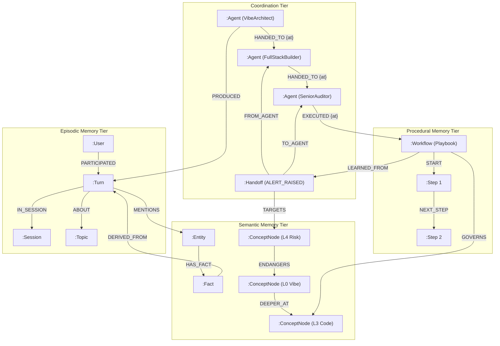

# GraphHacks Nexus — FalkorDB Multi-Agent Memory & Maturity Cockpit

> **Track Entered:** **Track 02 — Agent Memory and Coordination**  
> *(Unified with real Track 01 Code Graph and Track 03 Company Brain running on the same FalkorDB engine)*  
> **Event:** WeMakeDevs × FalkorDB Graph Hacks Hackathon

[](https://www.falkordb.com/)
[-009688.svg)](https://fastapi.tiangolo.com/)
[](https://react.dev/)
[](https://www.docker.com/)

---

## 📹 Submission Artifacts & Quick Links

- **Demo Video:** [https://youtu.be/mBmGK204FBM](https://youtu.be/mBmGK204FBM)
- **Architecture Blog & Deep Dive:** [`docs/architecture/blog.html`](./docs/architecture/blog.html)
- **Interactive Architecture Diagrams (C4 Level):**
  - [System Context Diagram](https://graphhacks-nexus-architecture.vercel.app/nexus-context.html)
  - [Container Architecture Diagram](https://graphhacks-nexus-architecture.vercel.app/nexus-container.html)
  - [Backend Components Diagram](https://graphhacks-nexus-architecture.vercel.app/nexus-component.html)
- **Cypher Queries File:** [`queries.cypher`](./queries.cypher)
- **Video Walkthrough Script:** [`docs/guides/DEMO-SCRIPT.md`](./docs/guides/DEMO-SCRIPT.md)

---

## 1. What It Is & The Core Innovation

GraphSync Nexus is a multi-agent engineering cockpit whose **memory and coordination layer is a real, load-bearing FalkorDB graph database**.

### The Problem: Cognitive Debt & Context Loss
In modern software teams:
1. **Beginner founders and vibe coders** talk in plain English feature ideas.
2. **Product Managers** track unit costs and API quotas.
3. **Junior developers** need endpoint wiring and file guides.
4. **Senior engineers** worry about concurrency, unthrottled external spend, and security.
5. **Principal architects** calculate Big-O complexity and graph algorithms.
6. When AI agents collaborate, their memory is usually lost in temporary RAM or fragmented across flat SQL tables and disjointed vector databases.

### The Solution:
GraphSync Nexus unifies all technical perspectives and agent memories into **one connected FalkorDB graph**:
- **The Builder Maturity Dial (L0 → L5):** A single graph is read at six progressive depths—from a plain-English "vibe" card (L0) to formal complexity proofs (L5).
- **17 Domain Lenses:** Every `:ConceptNode` carries an architectural domain (Frontend, Backend, Database, Security & Auth, External APIs, Mathematics, etc.).
- **4-Agent Collaborative Squad:** `VibeArchitect (L0-L1)` $\rightarrow$ `FullStackBuilder (L2-L3)` $\rightarrow$ `SeniorAuditor (L4-L5)` $\rightarrow$ `LearningCoach`.
- **Procedural Memory Guardrails:** When the Senior Auditor flags a missing rate limit on a WebSocket, it bubbles up an `[:ENDANGERS]` alert to L0. Clicking **1-Click Senior Fix** patches the code and saves a permanent `:Playbook` workflow to FalkorDB so future builds are born protected.

---

## 2. Load-Bearing Graph: The Real-Work Test (Rule 3)

The cockpit has **zero hardcoded fallback mock data**. If FalkorDB is offline, the app stops working by design:

```bash
# 1. Stop FalkorDB
# If running via Docker Compose (Option A):
docker compose stop falkordb
# If running standalone container (Option B):
docker stop falkordb

# 2. Reload http://localhost:5173
# -> Instantly renders the ErrorScreen ("FalkorDB unavailable (ConnectionError)")
# -> Backend answers HTTP 503

# 3. Start FalkorDB
# If running via Docker Compose (Option A):
docker compose start falkordb
# If running standalone container (Option B):
docker start falkordb

# 4. Click "Retry" in Cockpit -> The live graph renders cleanly!
```

---

## 3. The Graph Data Model

The graph model compositions live inside isolated FalkorDB named graphs (`tenant:<id>`), connected across four canonical tiers:



> Reads as: a `:User`/`:Agent` produces an episodic `:Turn` (in a `:Session`, about a `:Topic`); the turn mentions semantic `:Entity`/`:Fact` nodes and links the L0→L5 `:ConceptNode` projection; a SeniorAuditor flags an L4 risk that `[:ENDANGERS]` the L0 card, and the fix is stored as a replayable `:Workflow` linked back to the `:Handoff` via `[:LEARNED_FROM]`.

### 3.1 The Four Memory & Coordination Tiers

| Tier | Node Label | Key Properties | Purpose |
|---|---|---|---|
| **Episodic** | `:Session` | `id`, `started_at`, `title` | Contiguous conversational session |
| | `:Turn` | `id`, `timestamp`, `role`, `text`, `quality` | Atomic interaction/prompt event |
| **Semantic** | `:ConceptNode` | `id`, `name`, `persona_level`, `domain`, `status` | Architectural concept (L0 through L5) |
| | `:Entity` / `:Fact` | `id`, `statement`, `confidence` | Durable domain knowledge assertions |
| **Procedural** | `:Workflow` | `id`, `name`, `trigger_domain`, `learned_from` | Reusable engineering playbook |
| | `:Step` | `id`, `order`, `action`, `expected_result` | Action sequence inside a playbook |
| **Coordination** | `:Agent` | `id`, `name`, `role`, `persona_level` | Specialized squad member |
| | `:Handoff` | `id`, `created_at`, `reason`, `status` | State transfer ledger (`COMPLETED`, `ALERT_RAISED`, `PLAYBOOK_ENFORCED`) |

### 3.2 The Relationship Types (`[:]`)

- **`[:ENDANGERS]`**: Directed edge from an L4 security risk node to an L0 card, triggering the UI bubble-up alert.
- **`[:DEEPER_AT]`**: Connects a high-level concept down to its technical implementation.
- **`[:HANDED_TO]`**: Direct agent-to-agent coordination link.
- **`[:FROM_AGENT]` / `[:TO_AGENT]`**: Provenance ledger on `:Handoff` nodes.
- **`[:TARGETS]`**: Connects a handoff or audit to the specific `:ConceptNode` it inspected.
- **`[:LEARNED_FROM]`**: Links a procedural `:Workflow` back to the handoff alert that spawned it.
- **`[:IN_SESSION]` & `[:MODIFIED]`**: Links conversational turns to sessions and modified concept nodes.
- **`[:CALLS]`, `[:IMPORTS]`, `[:CONTAINS]`**: AST relationships in Track 01 code graphs.
- **`[:AUTHORED]`, `[:MODIFIED]`**: Git commit provenance in Track 03 company brain.

### 3.3 Named Graphs Topology

One FalkorDB instance holds all multi-tenant and multi-track projections via `db.named_graph(graph_key)`:

| Graph Key | Track / Role | What It Stores |
|---|---|---|
| **`tenant:<tenantId>`** | Track 02 Anchor | Four-tier agent memory, handoffs, and L0–L5 concept nodes |
| **`code:<repoId>`** | Track 01 Code Graph | Full AST symbol graph (`:File`, `:Symbol`, `:Test`, `[:CALLS]`, `[:IMPORTS]`) |
| **`company:brain`** | Track 03 Company Brain | Git commits, authors, file ownership, documentation drift |
| **`graphhacks_registry`** | Global Registry | Tenant workspaces (`:Tenant {key, name}`) |
| **`graphhacks_repos`** | Repo Registry | Repos loaded via "paste a GitHub URL" (`:Repo {id, name, url, loaded_at}`) |
| **`graphhacks_health`** | Health Monitor | Dedicated heartbeat graph (`MATCH (n) RETURN count(n)`) |

---

## 4. Local Setup Instructions

### Prerequisites
- **Docker & Docker Compose** (for FalkorDB and containerized execution)
- **Node.js 18+** & **npm** (for local frontend dev)
- **Python 3.12+** & [**uv**](https://docs.astral.sh/uv/) (for local backend dev)
- **Git** (to clone the repo)
- *(Optional)* **`graphify`** CLI — needed only for the "load any GitHub repo" feature: `uv tool install graphifyy`. Everything else runs without it.

### 0. Get the code
```bash
git clone https://github.com/shyler-web/GraphHacks.git
cd GraphHacks
```

---

---

### Option A: One-Command Setup with Docker Compose (Recommended)

1. **Start all services**:
   ```bash
   docker compose up --build
   ```
   *Starts FalkorDB on `6379` & `3000`, the FastAPI backend (internal to the Compose network), and the React Cockpit on `5173`. The cockpit proxies `/api` to the backend, so `:5173` is the only URL you need.*

2. **Seed the database (in a separate terminal)**:
   ```bash
   docker compose exec backend uv run python scripts/seed_cockpit.py
   ```
   *(Populates Tenant A, Tenant B, the Agent Squad, and initial memory graphs in FalkorDB)*

3. **Access the application**:
   - **React Cockpit UI:** [http://localhost:5173](http://localhost:5173)
   - **FalkorDB Web Browser:** [http://localhost:3000](http://localhost:3000)

---

### Option B: Native Step-by-Step Local Setup

1. **Start FalkorDB**:
   ```bash
   docker run -d --name falkordb -p 6379:6379 -p 3000:3000 falkordb/falkordb:latest
   ```

2. **Set up & Start Backend**:
   ```bash
   cd backend
   uv run python scripts/seed_cockpit.py
   uv run uvicorn app.main:app --port 8000
   ```
   > Runs **keyless** (no `.env` needed). To enable the optional LLM/search features, first `cp .env.example .env` in the repo root, fill in the keys, and add `--env-file ../.env` to the `uvicorn` command. Note: pass `--env-file ../.env` **only after** `.env` exists — uvicorn exits with `Invalid value for '--env-file': Path '../.env' does not exist` if the file is missing.

3. **Set up & Start Frontend** (from repository root):
   ```bash
   npm install
   npm run dev
   ```
   *Open [http://localhost:5173](http://localhost:5173) in your browser.*

---

### 4.1 Keyless-Safe Configuration

Only **FalkorDB** is a hard requirement. All external APIs degrade gracefully:
```bash
cp .env.example .env
```

| Key | Effect if Set | Fallback if Unset |
|---|---|---|
| `NEBIUS_API_KEY` | Live LLM agent squad synthesis & `/api/guidance` | Deterministic synthesizer used; guidance returns graph facts |
| `TAVILY_API_KEY` | Live cited web research for L4/L5 agents | Endpoint returns 503; UI degrades gracefully |
| `LANGSMITH_API_KEY` | Distributed tracing for all Cypher and LLM calls | Observability operations are silent no-ops |

How keys reach the backend:
- **Option B (native):** pass `--env-file ../.env` to `uvicorn` (after `cp .env.example .env`). Without the flag the backend simply runs keyless.
- **Option A (Compose):** the `backend` service reads `.env` automatically if present (`env_file` with `required: false`); absent, it runs keyless.

> **"Load any repo" needs the `graphify` CLI.** `POST /api/repos/load` (the cockpit's *paste a GitHub URL* bar) shells out to `git` + `graphify`. If `graphify` is not on `PATH`, it returns a clean `HTTP 409 {"detail":"graphify unavailable: …"}` and the UI shows an error banner — it never crashes. Install it with `uv tool install graphifyy` to enable that feature. All three tracks work on the bundled `graphhacks` repo without it.

---

## 5. Real Cypher Queries & Graph Algorithms

All production queries are located in [`queries.cypher`](./queries.cypher). Notable queries include:

### 1. Multi-Agent Bubble-Up Alerts (`[:ENDANGERS]`)
```cypher
MATCH (risk:ConceptNode {persona_level: 4, status: 'CRITICAL'})-[r:ENDANGERS]->(target:ConceptNode {persona_level: 0})
RETURN risk.name AS vulnerability, target.name AS affected_feature, r.severity AS severity;
```

### 2. Multi-Hop Blast Radius (Track 01)
```cypher
MATCH p=(root:Symbol {id: $symbolId})<-[:CALLS*1..2]-(affected:Symbol)
WHERE affected.id <> $symbolId
WITH affected, min(length(p)) AS hops
RETURN affected.id AS id, affected.label AS label, affected.source_file AS file,
       (affected:Test) AS is_test, hops
ORDER BY hops ASC, id ASC;
```

### 3. Native FalkorDB PageRank Hotspots (Track 01)
```cypher
CALL algo.pageRank('Symbol', 'CALLS')
YIELD node, score
RETURN node.label AS symbol, node.source_file AS file, score
ORDER BY score DESC
LIMIT 10;
```

### 4. Git Authorship Ownership Walk (Track 03)
```cypher
MATCH (f:File {path: $target})<-[m:MODIFIED]-(c:Commit)<-[:AUTHORED]-(p:Person)
RETURN p.name AS author, p.email AS email, count(c) AS commits,
       sum(m.insertions) AS insertions, sum(m.deletions) AS deletions
ORDER BY commits DESC;
```

---

## 6. Verification Proof Suite

Run the automated test suite from the `backend/` directory:

```bash
uv run python health.py                 # Graph health heartbeat (MATCH count)
uv run python scripts/verify_t2_2.py    # Episodic memory (turns order & persistence)
uv run python scripts/verify_t2_3.py    # Semantic memory & fact provenance
uv run python scripts/verify_t2_4.py    # Procedural memory (workflow step replay)
uv run python scripts/verify_t3_1.py    # Multi-agent coordination handoffs
uv run python scripts/verify_t3_2.py    # Structural per-tenant isolation (tenant_a=3, tenant_b=0)
uv run python scripts/verify_t3_3.py    # High-concurrency write safety
uv run python scripts/verify_track1.py  # Track 01 AST graph, PageRank & blast radius
uv run python scripts/verify_track3.py  # Track 03 100% cited provenance & drift detection
```

---

## 7. AI Assistant Disclosure (Rule 11)

An AI coding assistant (Claude / Antigravity Agent) was used under the author's direct supervision and architectural design. The author designed the multi-tier memory schema, selected FalkorDB multigraph isolation, verified all Cypher queries, executed every test suite, and verified end-to-end functionality. No AI-generated code was merged without passing automated verification and health checks.

---

## 8. Rule 10 Submission Checklist

- [x] **A public source-code repository** (this repository)
- [x] **A README with setup instructions and your graph data model** (Sections §3 and §4)
- [x] **The Cypher queries or graph algorithms the product depends on** ([`queries.cypher`](./queries.cypher) and Section §5)
- [x] **A demo video showing the working project** (Section §📹)
- [x] **Complete local setup instructions** (Section §4 — Docker Compose & Native Local verified)
- [x] **The track you are entering:** **Track 02 — Agent Memory and Coordination**
